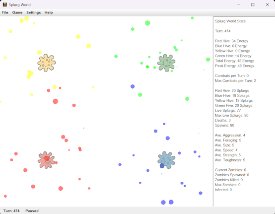

# Splurg World

<!-- Improved README: badges, TOC, compact properties, preserved gameplay content -->

[](https://openjdk.org/)
[](https://maven.apache.org/)

A simple desktop life simulator where little creatures called "Splurgs" live, fight, raid hives and evolve over time.

<p align="center">
  
</p>

---

## Table of contents
- [Overview](#overview)
- [Tech Stack](#tech-stack)
- [Quick start](#quick-start)
  - [Prerequisites](#prerequisites)
  - [Build](#build)
  - [Run](#run)
  - [Tests](#tests)
- [Configuration & resources](#configuration--resources)
- [Gameplay](#gameplay)
  - [What is a Splurg](#what-is-a-splurg)
  - [Stats & attributes](#stats--attributes)
  - [Spawning & breeding](#spawning--breeding)
  - [Zombies & degradation](#zombies--degradation)
  - [Controls](#controls)
- [Artifacts & logs](#artifacts--logs)
- [Troubleshooting](#troubleshooting)
- [Development notes](#development-notes)
- [License & next steps](#license--next-steps)

---

## Overview
`Splurg World` is a Java 21 desktop simulation/game that models populations of small creatures (Splurgs) and their interactions (combat, raiding, spawning, infection/zombies, and aging). The simulation is configurable via `src/main/resources/splurg.properties`.

Key facts:
- Main class: `org.jarec.Main`
- Module: `Splurg.World` (see `src/main/java/module-info.java`)
- Author: **Jarec** (from `splurg.properties`)
- Version: **01.10** (from `splurg.properties`)

---

## Tech Stack
A concise summary of the technologies and library versions used in this project (extracted from `pom.xml` and `module-info.java`):

- Java: JDK 21 (project compiler source/target set to 21)
- Build tool: Maven (pom.xml)
  - Plugins: `maven-jar-plugin` 3.3.0, `maven-shade-plugin` 3.5.0
- Libraries:
  - `org.slf4j:slf4j-api` — 2.0.12
  - `ch.qos.logback:logback-classic` — 1.4.11
  - `com.google.guava:guava` — 31.1-jre
  - `org.json:json` — 20231013
- Testing:
  - `org.junit.jupiter:junit-jupiter` — 5.10.0 (test scope)
  - `org.mockito:mockito-core` — 5.10.0 (test scope)
- Module system: `module Splurg.World` (requires `com.google.common`, `java.datatransfer`, `java.desktop`, `org.slf4j`, `org.json`)
- Packaging: executable jar (manifest mainClass `org.jarec.Main`; Shade plugin configured)

Notes: run `mvn dependency:tree` to inspect full transitive dependencies.

---

## Quick start

### Prerequisites
- Java 21 (JDK)
- Maven 3.x

Verify Java is the expected major version:

```bash
java -version
mvn -v
```

### Build

From the repository root:

```bash
mvn clean package
```

Produce a faster local build (skip tests):

```bash
mvn -DskipTests package
```

The build produces jars in `target/` (pom is configured with a Shade transformer and `org.jarec.Main` as the entry point).

### Run

After packaging:

```bash
java -jar target/Splurg_World-1.0.jar
```

Notes:
- Running creates a `logs` directory for runtime logs.
- If you run from an IDE, ensure the module path and resources are available.

### Tests

Run unit tests:

```bash
mvn test
```

Reports: `target/surefire-reports/`.

---

## Configuration & resources

The primary configuration file is `src/main/resources/splurg.properties`. It contains game tuning values (attributes, hive settings, zombie options and image names).

<details>
<summary>Click to view properties (collapsed for readability)</summary>

Key properties include (see the file for exact values):

- `author`, `version`
- `splurg.default.*` (attributes, breeding, energy, degradation)
- `hive.default.*` (setup energy, spawn rate, spawn energy, size, position)
- `game.*` (max concurrent thresholds, default toggles for zombies/herding)
- `zombie.default.*` (activation delay, aggression, health, speed multiplier)
- `winning.image.*` (images shown at game end)

All images and resources under `src/main/resources/` are copied to `target/classes/` during build. Notable images referenced: `Red_Wins.png`, `Blue_Wins.png`, `Green_Wins.png`, `Yellow_Wins.png`, `Nobody_Wins.png`, `Truce.png`, `splash_image.png`, `icon.png`.

</details>

---

## Gameplay

### What is a Splurg
A Splurg is an asexual amoeba-like creature that fights, feeds and reproduces. They raid hives for energy, fight other Splurgs, and can become infected/zombies.

### Stats & attributes
A number of statistics are shown in the right-hand side panel. Many are randomized at spawn and some are derived from others.

- Aggression: a random value (1–10). Determines detection range to attack other Splurgs.
- Foraging: a random value (1–10). Determines detection range to raid Hives.
- Strength: random (1–10). Damage dealt in combat.
- Toughness: random (1–10). Damage resisted in combat.
- Size: derived as (Toughness + Strength) / 2.
- Speed: derived from Size (larger size → slower speed).
- Charisma: derived from Size and stored Energy.
- Loner: random (1–10). Determines tendency to follow others with higher Charisma.
- Energy: not an attribute but collected by injuring Splurgs or raiding Hives; used to heal or breed.

### Spawning & breeding
- Hives spawn Splurgs when they have enough energy (`hive.default.spawn.energy`).
- Herding: Splurgs with low `Loner` follow others with higher `Charisma`.
- Breeding: when two Splurgs meet and have enough energy, they can spawn a new Splurg. Offspring inherit attributes (fully random unless parents share an attribute value).

### Splurg degradation & life expectancy
- Splurgs can degrade (lose Strength or Toughness) over time. Controlled by `splurg.degradation` (set to 0 to disable).
- Splurgs have a maximum lifespan (`splurg.default.spawn.age`). After this age there's an increased chance of death unless they consume Energy.

### Zombies
- Can be enabled/disabled via settings (`game.default.zombie`).
- Zombies do not collect or spend energy: they only attack.
- Dead Splurgs may become Zombies depending on `zombie.default.change` and hive counts.
- Splurgs injured by Zombies become Infected and will become Zombies when they die.

### Controls
- ESC — Stop the game
- Space — Pause / resume
- Left arrow — Slow down simulation
- Right arrow — Speed up simulation
- Up arrow — Reset to default speed
- Mouse click (while paused) — Show stats for Splurgs in the clicked area

---

## Artifacts & logs
- Packaged jar: `target/Splurg_World-1.0.jar` (and possibly a shaded jar)
- Compiled classes & resources: `target/classes/`
- Test reports: `target/surefire-reports/`
- Runtime logs: `logs/splurg.log` (created by the app at startup)

---

## Troubleshooting
- Module/run errors: make sure you're running with Java 21 (the project is compiled for Java 21).
- Missing resources: verify `target/classes/` contains resource files after building.
- Dependency issues: run `mvn dependency:tree` to inspect.

---

## Development notes
- The `Main` class prints author & version (from `splurg.properties`) and initializes the GUI (`WorldFrame.getInstance()`).
- Module requires: `com.google.common`, `java.desktop`, `org.slf4j`, `org.json` (see `module-info.java`).

---

## License & next steps
No `LICENSE` file was found. Consider adding one (MIT or Apache-2.0 are common).

Suggestions to improve the repo:
- Add `mvnw` (Maven wrapper) so contributors can build without installing Maven.
- Add a GitHub Actions workflow to run `mvn -DskipTests package` and `mvn test` on push/PR.
- Add a short `CONTRIBUTING.md` and a `LICENSE` file.

---
